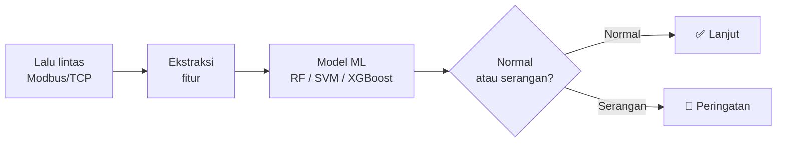

**[Tentang](#-tentang-saya) • [Teknologi](#️-tumpukan-teknologi) • [Proyek](#-proyek-unggulan) • [Statistik](#-statistik-github) • [Kontak](#-mari-terhubung)**

---

## 👨‍💻 Tentang Saya

Saya tertarik pada pertemuan antara **kecerdasan buatan** dan **keamanan infrastruktur industri**. Saya suka membangun sistem yang bukan hanya jalan, tapi juga **aman dan bisa dipercaya**.

<table>
<tr>
<td width="50%" valign="top">

### 🔭 Sedang Saya Kerjakan
- 🔐 Deteksi intrusi **SCADA Modbus/TCP** dengan machine learning
- 🤖 Pengenalan wajah dengan **Django + OpenCV**
- 📡 Telemetri **IoT** dengan ESP32 dan MQTT

</td>
<td width="50%" valign="top">

### 🌱 Sedang Saya Pelajari
- 🛡️ Keamanan jaringan ICS/OT
- 📈 Analisis lalu lintas jaringan
- ☁️ Komputasi awan dan deployment

</td>
</tr>
</table>

---

## 🛠️ Tumpukan Teknologi

**Bahasa Pemrograman**

**Kerangka Kerja & Pustaka**

**Basis Data, Alat & Perangkat Keras**

 

| Bidang | Alat & Teknologi |
|---|---|
| 🤖 **Machine Learning** | Random Forest, SVM, XGBoost, Scikit-Learn |
| 🔐 **Keamanan & Jaringan** | Cisco Packet Tracer, GNS3, MikroTik RouterOS, Analisis Modbus/TCP |
| 📡 **IoT & Perangkat Keras** | ESP32, ESP8266, Sensor, MQTT |
| 🌐 **Web & Backend** | Flask, Django, Streamlit, MySQL, PostgreSQL |

---

## 📌 Proyek Unggulan

### 🛡️ SCADA Modbus Intrusion Detection System

Sistem deteksi intrusi untuk jaringan ICS memakai pembelajaran mesin (Random Forest, SVM, XGBoost).

### 🔑 Face Recognition Smart Lock

Kontrol akses pintu otomatis berbasis pengenalan wajah, dibangun dengan Django dan OpenCV.

### 🏠 Smart Home IoT Telemetry

Pemantauan rumah pintar dengan streaming data langsung memakai ESP32 dan protokol MQTT.

 

| Proyek | Repo |
|---|---|
| 🛡️ SCADA Modbus IDS | [scada-modbus-ids](https://github.com/ardhika13/scada-modbus-ids) |
| 🔑 Face Recognition Smart Lock | [face-recognition-smart-lock](https://github.com/ardhika13/face-recognition-smart-lock) |
| 🏠 Smart Home IoT Telemetry | [smart-home-iot-telemetry](https://github.com/ardhika13/smart-home-iot-telemetry) |

---

## 📊 Statistik GitHub

---

## 🤝 Mari Terhubung

Terbuka untuk diskusi dan kolaborasi soal **keamanan SCADA/ICS, machine learning, dan IoT**.

*"Bangun, uji, amankan, ulangi."* 🚀

