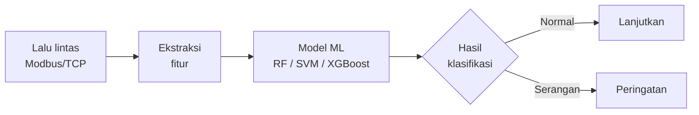

### Mahasiswa Informatika, Universitas Teknologi Ronggolawe Cepu

---

## Tentang Saya

Saya mahasiswa Informatika yang berfokus pada pertemuan antara **kecerdasan buatan** dan **keamanan infrastruktur industri**. Saya membangun sistem yang tidak hanya berfungsi, tetapi juga dapat dipercaya dan aman.

**Bidang yang sedang saya dalami**

| Fokus | Penjelasan |
|---|---|
| **Keamanan SCADA/ICS** | Analisis dan deteksi serangan pada jaringan industri berbasis Modbus/TCP |
| **Machine Learning** | Klasifikasi anomali dengan Random Forest, SVM, dan XGBoost |
| **IoT** | Telemetri sensor real-time dengan ESP32 dan MQTT |
| **Jaringan Komputer** | Simulasi dan konfigurasi jaringan dengan Cisco Packet Tracer, GNS3, MikroTik |

---

## Teknologi

 

| Kategori | Alat |
|---|---|
| Bahasa | Python, PHP, C++ |
| Kerangka kerja dan pustaka | Streamlit, Flask, Django, OpenCV, Scikit-Learn |
| Jaringan dan keamanan | Cisco Packet Tracer, GNS3, MikroTik RouterOS, Analisis Modbus/TCP |
| IoT dan perangkat keras | ESP32, ESP8266, Sensor, MQTT |
| Basis data dan alat | MySQL, PostgreSQL, Git, GitHub |

---

## Proyek Unggulan

### SCADA Modbus Intrusion Detection System

Sistem deteksi intrusi untuk jaringan ICS memakai pembelajaran mesin. Model dilatih dari fitur lalu lintas Modbus/TCP untuk membedakan trafik normal dan serangan.

`Python` `Scikit-Learn` `XGBoost` `Modbus/TCP` | [Lihat repositori](https://github.com/ardhika13/scada-modbus-ids)

 

### Face Recognition Smart Lock

Kontrol akses pintu otomatis berbasis pengenalan wajah. Sistem memverifikasi wajah melalui kamera lalu mengaktifkan kunci secara otomatis.

`Django` `OpenCV` `Python` | [Lihat repositori](https://github.com/ardhika13/face-recognition-smart-lock)

 

### Smart Home IoT Telemetry

Pemantauan rumah pintar dengan streaming data langsung dari sensor ESP32 menggunakan protokol MQTT.

`ESP32` `MQTT` `Sensor` | [Lihat repositori](https://github.com/ardhika13/smart-home-iot-telemetry)

---

## Statistik GitHub

---

## Kontak

Terbuka untuk diskusi, kolaborasi, dan kesempatan magang di bidang **keamanan siber industri, machine learning, dan IoT**.

