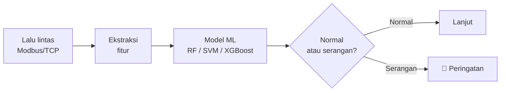

---

## 👨‍💻 Tentang Saya

Saya tertarik pada pertemuan antara **kecerdasan buatan** dan **keamanan infrastruktur industri**. Saat ini saya mengerjakan:

- 🔐 Deteksi intrusi pada jaringan **SCADA Modbus/TCP** dengan machine learning
- 🤖 Sistem pengenalan wajah berbasis **Django + OpenCV**
- 📡 Telemetri **IoT** dengan ESP32 dan MQTT
- 🎓 Mendalami analisis lalu lintas jaringan dan keamanan ICS

---

## 🛠️ Tumpukan Teknologi

| Bidang | Alat & Teknologi |
|---|---|
| 🤖 **Machine Learning** | Random Forest, SVM, XGBoost, Scikit-Learn |
| 🔐 **Keamanan & Jaringan** | Cisco Packet Tracer, GNS3, MikroTik RouterOS, Analisis Modbus/TCP |
| 📡 **IoT & Perangkat Keras** | ESP32, ESP8266, Sensor, MQTT |
| 🌐 **Web & Backend** | Flask, Django, Streamlit, MySQL, PostgreSQL |

---

## 📌 Proyek Unggulan

### 🛡️ SCADA Modbus Intrusion Detection System

Sistem deteksi intrusi untuk jaringan ICS memakai pembelajaran mesin.

`Python` `Scikit-Learn` `XGBoost` `Modbus/TCP`

### 🔑 Face Recognition Smart Lock

Kontrol akses pintu otomatis berbasis pengenalan wajah.
`Django` `OpenCV` `Python`

### 🏠 Smart Home IoT Telemetry

Pemantauan rumah pintar dengan streaming data langsung.
`ESP32` `MQTT` `Sensor`

| Proyek | Repo |
|---|---|
| SCADA Modbus IDS | [scada-modbus-ids](https://github.com/ardhika13/scada-modbus-ids) |
| Face Recognition Smart Lock | [face-recognition-smart-lock](https://github.com/ardhika13/face-recognition-smart-lock) |
| Smart Home IoT Telemetry | [smart-home-iot-telemetry](https://github.com/ardhika13/smart-home-iot-telemetry) |

---

## 📊 Statistik GitHub

---

## 🤝 Mari Terhubung

Terbuka untuk diskusi soal **keamanan SCADA/ICS, machine learning, dan IoT**. Silakan hubungi lewat LinkedIn atau email di atas.

F
